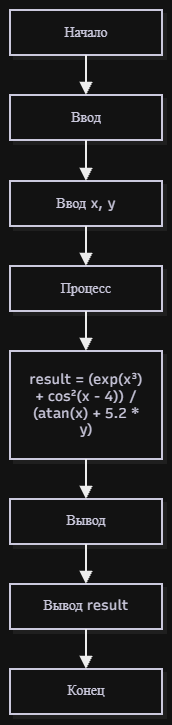

# Домашнее задание к работе 5

## Условие задачи
Вариант 21. Вычислить значение функции:

$$F(x, y) = \frac{e^{x^3} + \cos^2(x - 4)}{\mathrm{arctg}\, x + 5{,}2y}$$

Параметры x и y вводятся пользователем. Контрольные значения:
- F(2,1·10⁻³, 10) = 0.027486
- F(1,9, −1) = −231.400828

## 1. Алгоритм и блок-схема

### Алгоритм
1. Начало.
2. Подключить математическую библиотеку `math.h`.
3. Ввести вещественные числа x и y с клавиатуры.
4. Вычислить числитель: `exp(x³) + cos²(x − 4)`.
5. Вычислить знаменатель: `atan(x) + 5.2 * y`.
6. Вычислить результат: числитель / знаменатель.
7. Вывести результат в консоль с точностью 6 знаков после запятой.
8. Конец.

### Блок-схема


## 2. Реализация программы

Файл: [main.c](main.c)

## 3. Результаты работы программы

```
Введите x и y: 0.0021 10
F(0.0021, 10) = 0.027486
```

```
Введите x и y: 1.9 -1
F(1.9, -1) = -231.585509
```

## 4. Информация о разработчике

Плотников Антон, бТИИ-262

